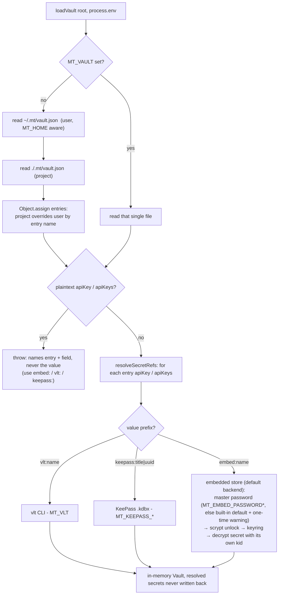
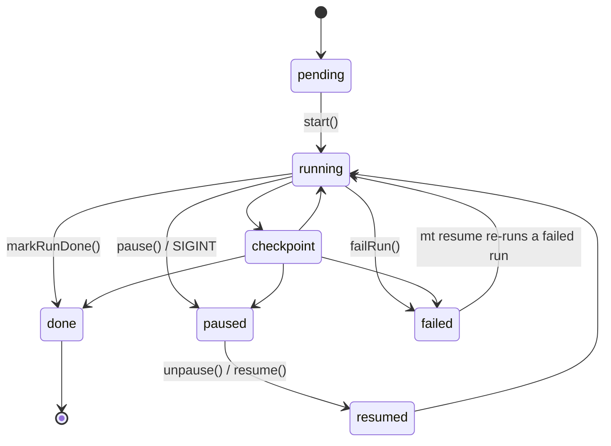
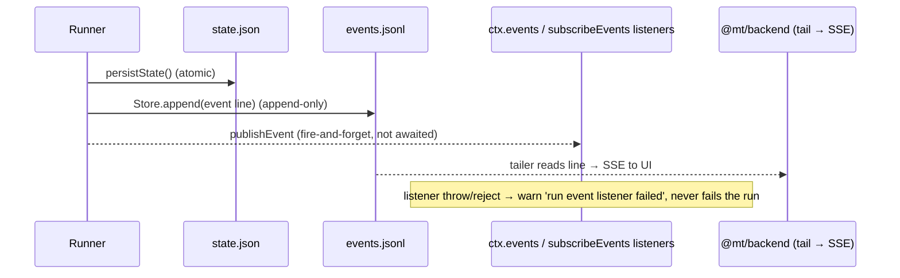
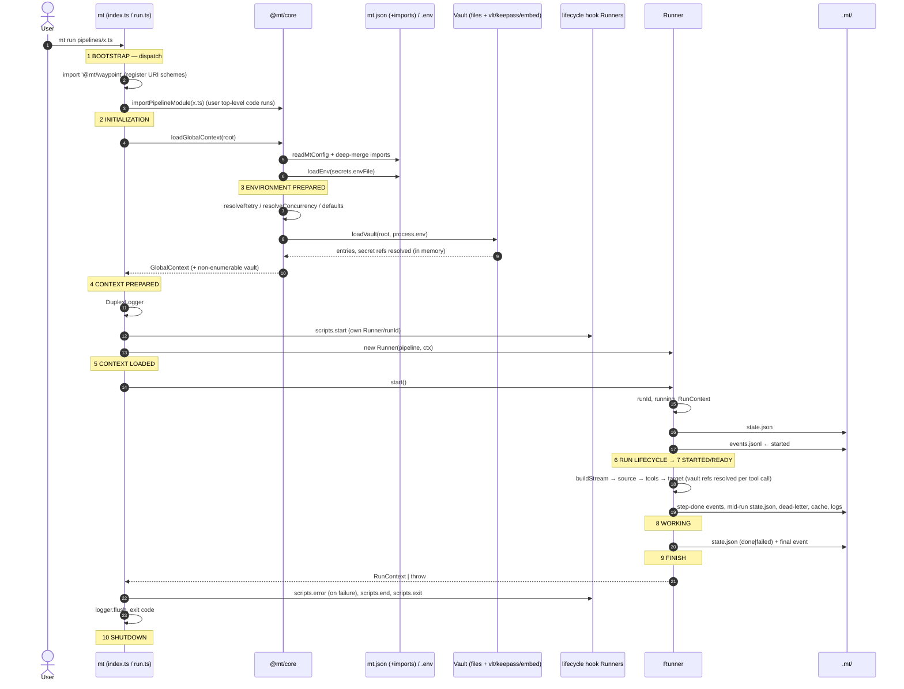

# Lifecycle — from `mt run` to shutdown (and `mt explain`)

> **Scope:** What happens, in order, from process start to process exit — and *where* config eval,
> `.env` loading, vault loading, module import, URI alias/registry lookup, hooks, events and
> checkpoints each fit in.
> **Entry points traced:** `mt run`, `mt resume`, `mt install`, `mt explain` (read-only)
> (`packages/cli/src/commands/`).
> **Related:** [architecture.md](architecture.md) · [steering/core.md](../steering/core.md) ·
> [steering/cli.md](../steering/cli.md) · [vault.md](vault.md)

---

## 1. Phase map

```
BOOTSTRAP → INITIALIZATION → ENVIRONMENT PREPARED → CONTEXT PREPARED → CONTEXT LOADED
          → RUN/TOOL LIFECYCLE → STARTED/READY → WORKING → FINISH → SHUTDOWN
```

These are documentation phases, not code states. The only *code* state machine is the run state
machine (§5). Each phase below names the function that does the work.

`mt explain` takes a short path: BOOTSTRAP → INITIALIZATION (pipeline import) → read `mt.json` →
render. It never enters phases 4–10 and does not build a `GlobalContext`, load `.env`, resolve the
vault, construct a `Runner` or run a hook (see §3a).

```mermaid
flowchart LR
  A[1 BOOTSTRAP<br/>binary + arg dispatch] --> B[2 INITIALIZATION<br/>side-effect imports,<br/>pipeline module import]
  B --> C[3 ENVIRONMENT PREPARED<br/>mt.json eval + imports merge,<br/>.env, process.env]
  C --> D[4 CONTEXT PREPARED<br/>defaults, settings, uris,<br/>GlobalContext + vault]
  D --> E[5 CONTEXT LOADED<br/>logger, hook scripts,<br/>Runner + RunContext]
  E --> F[6 RUN/TOOL LIFECYCLE<br/>Runner.start / resume]
  F --> G[7 STARTED / READY<br/>state=running, 'started' event]
  G --> H[8 WORKING<br/>source → tools → target]
  H --> I[9 FINISH<br/>done / failed / paused]
  I --> J[10 SHUTDOWN<br/>end/exit hooks, flush, exit code]
```



### Where does X happen? (quick answer)

| Concern | Phase | Code |
|---|---|---|
| Binary / arg dispatch | 1 Bootstrap | `cli/src/index.ts` `main()` |
| `mt explain` (import + `mt.json` read + render) | 2 → 3 (read-only) | `loadRunnable()`, `readMtConfig()`, `renderExplanation()` in `explain.ts`; skips phases 4–10 (§3a) |
| `import '@mt/waypoint'` (URI scheme registration) | 2 Initialization | top of `cli/src/commands/run.ts` — ES import side effect, runs at module load |
| Pipeline `.ts` import (user code executes here) | 2 Initialization* | `importPipelineModule()` ← `loadPipeline()` in `run.ts` |
| `mt.json` read + `imports` deep-merge | 3 Environment | `readMtConfig()` in `core/src/config.ts` |
| `.env` (`secrets.envFile`) load | 3 Environment | `loadEnv()` / `parseEnvFile()` |
| Config eval → defaults/retry/concurrency validation | 4 Context prepared | `loadGlobalContext()` → `resolveRetry`, `resolveConcurrency` |
| `uris` alias table | 4 (stored) / 8 (expanded) | stored in `settings.uris`; expanded by `registry.expandAliases()` per source/target step |
| **Vault load** (files + secret refs) | 4 Context prepared | `loadVault()` inside `loadGlobalContext()` |
| **Vault ref resolve** (`vault://entry/model`) | 8 Working (lazy, per tool call) | `resolveLlmConfigFromCtx()` → `expandVaultRef()` → `resolveVaultRef()` |
| Logger creation | 5 Context loaded | `new DuplexLogger(.mt/runs)` |
| `scripts.start` hook | 5 Context loaded | `runLifecycleScript(ctx, 'start')` |
| `Runner` ctor (Store, Cache, state machine, listeners) | 5 Context loaded | `new Runner(pipeline, ctx, opts)` |
| Run id minted, `RunContext` built | 6 Run lifecycle | `Runner.start()` → `createRunContext()` |
| `state.json` first write + `started` event | 7 Started | `persistState()` → `emitEvent('started')` |
| Source open / tool invoke / target write | 8 Working | `buildStream()`, `runToolItem()`, `writeTarget()` |
| Cache lookup, retry, error policy | 8 Working | `tryCacheGet()`, `withRetry()`, `writeDeadLetter()` |
| Terminal state + `done`/`failed` event | 9 Finish | `markRunDone()` / `failRun()` |
| `scripts.error` / `end` / `exit` hooks, logger flush | 10 Shutdown | tail of `runCommand()` |

\* Pipeline import happens **before** `loadGlobalContext` in `mt run` (and in `mt resume` it
happens *after*). Top-level code in a pipeline module therefore runs with **no** GlobalContext —
it must not assume the vault or `.env` exist yet. See §3.

---

## 2. Phase 1 — BOOTSTRAP

Process starts, `main()` slices `process.argv` and dispatches on the first arg.

- Core commands (`init`, `run`, `resume`, `ls`, `inspect`, `tool`) are statically imported.
- Heavy ones (`serve`, `router`, `install`, `vault`) are **lazy** `await import(...)` so
  `mt run` never pays for h3 / SQLite.
- Single-file `mt` binary (Bun `--compile`): before dispatch it installs its own pipeline loader via
  `setPipelineModuleLoader()`. Everything else uses plain dynamic `import()`.
- Fatal error in `main()` → `Fatal error: …`, exit 1.

Nothing is read from disk yet: no config, no env, no vault.

---

## 3. Phase 2 — INITIALIZATION (imports)

Two kinds of import happen here, and the order matters.

1. **Static module imports** of `run.ts`: `@mt/core`, and the side-effect import
   `import '@mt/waypoint'`, which calls `registry.registerSource/registerTarget(scheme, factory)` for
   `jsonl://`, `md://`, `http://`, `chapter://`, … After this, URI strings can be resolved.
2. **Pipeline module import** — `loadPipeline(file, name?)` → `importPipelineModule(abs)`:
   - uses the binary loader if installed, else `await import(path)`;
   - the module's top-level code **executes now** (plain `import`s, `console.log`, `definePipeline()` calls);
   - result must expose `default` (or `pipeline`, or `--pipeline <name>`) with a string `id`;
     otherwise `Invalid pipeline module: …`;
   - `definePipeline()` only *builds* a step list — no source opened, no tool invoked, no URI resolved.
   - load failures get hints (`nativeAddonHint`, `packageResolutionHint`) when they look like a native
     addon / unresolved package.

> **Gotcha:** in `mt run`, pipeline import precedes `loadGlobalContext`. Don't read `ctx.vault` or
> `ctx.env` at module top level; read them inside tools/`tap`/`flatMap` callbacks, which receive a
> context at run time.

---

## 3a. `mt explain` — read-only short path

`mt explain <pipeline.ts> [--pipeline <name>] [--json]` answers "what would this declaration do?"
without executing it. It is the only lifecycle entry point that stops before context construction.

1. **Bootstrap + initialization.** Same dispatch as `mt run`; `explain.ts` imports `@mt/waypoint`, so
   URI schemes and aliases can be resolved.
2. **Pipeline module import.** `loadRunnable(file, name?)` is the *same* selector `mt run` uses
   (named export → default suite → default pipeline → implicit suite). The module's top-level code
   **does execute** — imports, `console.log`, `definePipeline()` and any other side effects happen
   exactly as they would for a run.
3. **Config read only.** `readMtConfig(projectRoot)` reads `mt.json` (plus its `imports`) for
   `project.name`, `defaults`, `uris` aliases and `scripts.*`. **No** `GlobalContext` is built: no
   `loadEnv()`, no `loadVault()`, no secret-ref resolution, no vault or `.env` access.
4. **Static walk.** The command recursively walks `pipeline.steps`, expands URI aliases through the
   registry, merges each tool step's retry/`onError` with pipeline and project defaults, and records
   step-id, checkpoint-node and artifact-path patterns. It then renders Markdown or `--json`.

`mt explain` never starts a `Runner`, source (`start`/`resume`), tool (`invoke`), target
(`open`/`write`/`close`) or lifecycle hook. It writes no `.mt` state: there is **no run id, no
`.mt/runs/<runId>/` directory, no `state.json`, `context.json`, `events.jsonl`, `run.log`, `logs/`,
`dead-letter.jsonl`, `artifacts/` or cache entry**. The output describes the paths a later
`mt run` would create; it does not create them.

Consequences:

- The view is a declaration, not proof of runtime success: no source file/URI is opened, no tool is
  validated and no target is touched.
- Unresolvable aliases become warnings in the output rather than runtime errors.
- Top-level module code that reads `process.env`, opens files or calls APIs still runs on import.
  Keep pipeline modules side-effect-free outside `definePipeline()`.
- Import-time stdout is captured during the import and replayed on stderr, so the explanation itself
  (Markdown or one JSON document) is never mixed with module `console.log` output.
- Because no `GlobalContext` exists, `mt explain` cannot report resolved vault refs or actual `.env`
  values.

---

## 4. Phases 3–4 — ENVIRONMENT & CONTEXT PREPARED (`loadGlobalContext`)

One function, `loadGlobalContext(projectRoot)` in `core/src/config.ts`, shared by `mt run`,
`mt resume`, `mt install` and the backend start route. Steps in order:

1. **`readMtConfig(root)`** — read `mt.json`.
   Missing file → `DEFAULT_MT_CONFIG`. Malformed → throws.
   `imports: ["./mt.local.json", …]` are read next and **deep-merged over** the base file
   (objects merge key-by-key, everything else is replaced; later import wins; missing import skipped;
   cycles guarded by a `seen` set).
2. **Settings:** `settings = { ...config.settings }`, plus `settings.uris = config.uris`.
3. **`loadEnv(root, secrets.envFile ?? '.env')`** — parse the env file
   (`export ` prefix, quotes, `#` comments). The result goes into `ctx.env`.
   `process.env` always wins and is **never written to**.
4. **Defaults eval/validation:**
   `resolveRetry()` (max / backoffMs / strategy / maxBackoffMs) and `resolveConcurrency()`
   (must be a positive integer, else `Invalid mt.json: defaults.concurrency …`). `onError` default applies.
5. **Build `GlobalContext`:** `{ project{name,root}, defaults, settings, env }`.
6. **`loadVault(root, process.env)`** → attached as a **non-enumerable** property `ctx.vault`
   (never in `JSON.stringify`, spreads, checkpoints, logs).

### Vault load detail



- **Plaintext keys are rejected**, not passed through: any `apiKey`/`apiKeys[i]` without a `vlt:`,
  `keepass:` or `embed:` prefix fails the load (and `mt vault add` / `saveVault`).
- `embed:` is the zero-config default: with no `MT_EMBED_PASSWORD(_FILE)` the built-in public
  password is used and a one-time warning says the store is only obfuscated (fix: `mt vault embed-rekey`).
  Each secret is AES-256-GCM encrypted under its own encryption key (`kid`) from the store's keyring.
- Missing vault file is fine (empty vault). A failing ref throws
  `Vault entry "<name>": …` — **names the entry, never the secret value**.
- Refs are resolved **eagerly at load** (phase 4), every run, even if no tool uses the vault.
- The vault *file* keeps the refs; resolved plaintext lives only in process memory.
- Vault is a plain data store here. Mapping an `llm.use: "vault://openrouter/gpt"` to a
  provider/baseUrl/key happens later, lazily, in phase 8 (see §7).

---

## 5. Phase 5 — CONTEXT LOADED (CLI-side wiring)

Back in `runCommand` after `loadGlobalContext`:

1. `new DuplexLogger(.mt/runs)` — console + file. Not bound to a run yet.
2. `logger.info("Starting pipeline …")`.
3. **`scripts.start` hook** — `runLifecycleScript(ctx, 'start')`:
   - re-reads `mt.json` (`readMtConfig`), looks up `scripts.start`; absent ⇒ no-op;
   - `importPipelineModule(script)` (same import rules as §3), expects a `definePipeline()` export;
   - runs it with **its own** `Runner` against the same `GlobalContext` ⇒ the hook is a full run
     with its own `runId`, `state.json`, `events.jsonl`;
   - an error here **fails the command** (nothing else started yet).
4. `new Runner(pipeline, ctx, { pipelineFile, pipelineName })` — constructor only wires:
   `Store(.mt)`, `Cache(.mt)`, `RunStateMachine` (`pending`), seeds `RunnerOptions.events` listeners,
   reads `settings.runner.persist.every` (default **50**). No I/O, no run id yet.
5. `process.on('SIGINT', …)` registered (→ pause path, §9).

Other hook points: `scripts.install` (`mt install` only), `scripts.resume` (`mt resume`, errors swallowed),
`scripts.stop`, `scripts.error`, `scripts.end`, `scripts.exit` — see §9–10.

---

## 6. Phases 6–7 — RUN/TOOL LIFECYCLE → STARTED / READY

`runner.start()`:

1. `runId = randomUUID()` (minted synchronously — the CLI binds its logger to
   `.mt/runs/<runId>/run.log` right after calling `start()`, before awaiting).
2. `stateMachine.transition('running')` (`pending → running`).
3. `createRunContext()` → `RunContext { runId, pipelineId, startedAt, global, checkpoint, logger, artifactsDir }`.
   Context chain is backrefs: `GlobalContext ← RunContext ← ToolContext/SourceContext/TargetContext`.
4. `persistState()` → atomic write (temp + rename) of `.mt/runs/<runId>/state.json`
   (state, checkpoint tree, `pipelineId`, `pipelineFile`, `pipelineName`).
5. `emitEvent('started')` — **READY**. File line first, listeners second (§8).

`resume(runId)` differs: reads `state.json` (rejects `done`, rejects `pipelineId` mismatch), resets the
state machine to the stored state, restores the checkpoint tree, `→ resumed → running`, emits `resumed`,
then executes from the first non-`done` node. No new run id, no `started` event.
In `mt resume` the pipeline file is taken from `state.json` unless passed explicitly.

### Run state machine



`paused → done` is illegal; `markRunDone()` first unravels a late pause (`paused → resumed → running`)
so a finished run is never stranded in `paused`. `checkpoint` is a legal transition target, but the
current Runner never calls `transition('checkpoint')`; treat it as reserved, not an observed state.

---

## 7. Phase 8 — WORKING

`executeSteps()` → `buildStream(pipeline, null, runContext)` builds a lazy async-iterator chain and
`drainStream()` pulls it. Steps are a recursive fold; `fork` / `subflow` call `buildStream` again.

```mermaid
sequenceDiagram
  autonumber
  participant R as Runner
  participant Reg as URI registry
  participant S as Source
  participant T as Tool(s)
  participant C as Cache
  participant G as Target
  participant FS as .mt/runs/<id>

  R->>Reg: expandAliases(uri, settings.uris)  (@alias → scheme://…)
  R->>Reg: resolveSource(uri)  (or step instance)
  alt cursor in checkpoint & Source.resume
    R->>S: resume(ctx, cursor)
  else
    R->>S: start(ctx)
  end
  loop each Exchange (pulled by target)
    S-->>T: Exchange
    T->>C: tryCacheGet (only if tool.cacheable)
    alt hit
      C-->>T: cached Exchange (id restored)
    else miss
      T->>T: withRetry(tool.invoke(ex, ToolContext))
      Note over T: LLM tools: resolveLlmConfigFromCtx → vault ref expand
      alt failed after retries
        T->>FS: onError: fail-run=throw / skip-item / dead-letter.jsonl
      end
      T->>C: cache.set (best-effort)
    end
    T-->>G: Exchange
    G->>G: write(ex)
    R->>FS: schedulePersist() every N writes (default 50)
  end
  Note over R,G: step stream dry → emitEvent('step-done', stepId)
  R->>G: close()  (commit; temp→rename)
  R->>FS: step-done event + persist
```

Key rules while working:

- **Pull-based:** the target drives the pipeline. Source items are only produced as fast as the sink
  consumes them (back-pressure); `step-done` for upstream steps is emitted as their streams run dry,
  before the sink's own `step-done`.
- **Target lifecycle:** `open()` → `write()`* → `close()` (close in `finally`, then untrack). Temp+rename
  targets publish on `close()`.
- **Mid-run persist:** every `runner.persist.every` writes and at each target-step boundary. One
  in-flight write + dirty flag; the persisted source cursor is clamped to the target's durably
  committed count (`Target.checkpoint?()`), so a crash never skips unflushed output.
- **Auto-commit:** `?commit=on-close` on a target URI → `autoCommit` stages only that target's output
  path after close.
- **Retry / error:** merge order tool step > pipeline > global (`mt.json defaults`).
  `fail-run` aborts → `failRun()`. `skip-item` and `dead-letter` return `undefined` and the item drops.
- **Cache** is purely an optimisation: key or read/write errors degrade to a miss with a warn log.
- **Per-step logs:** `.mt/runs/<id>/logs/<stepId>.log`, best-effort (write errors swallowed).

### Vault resolution inside a tool (lazy)

Tools never read vault files. At invoke time an LLM tool calls
`resolveLlmConfigFromCtx(toolCtx, { input, tool, meta })`, which reads `ctx.run.global.vault`,
`settings`, `env`, `routerUrl` and merges layers:

```
input > tool option > exchange llm var/meta.llm > mt.json settings (llm.*)
      > vault ref (llm.use / MT_LLM_USE → vault://entry[/model]) > provider env > preset defaults > generic MT_LLM_* env
```

The vault ref (`vault://<entry>[/<model>]` or `@vault/<entry>[/<model>]`) expands into **one** layer
(provider, baseUrl, apiKey(s), headers, model = ref model ?? entry.defaultModel) placed right below the
layer that carried the ref. Failure modes: no vault loaded, unknown entry (lists available names),
model not in entry, or a higher layer pinning a different provider — all error without printing secrets.
Resolved secrets never reach `meta`, checkpoints, logs, or `sources` (reported as `vault:<entry>`).

---

## 8. Events

Two channels, one ordering rule: **`state.json` write → `events.jsonl` append → in-process listeners**.

| `RunEventType` | When | Extra |
|---|---|---|
| `started` | `start()` persisted initial state | — |
| `step-done` | a step's stream ran dry / target finished / nested fork-subflow completed | `stepId` |
| `paused` | `pause()` persisted | — |
| `resumed` | `unpause()` / `resume()` back to `running` | — |
| `done` | terminal `done` persisted | — |
| `failed` | `failRun()` persisted | `error` |



- Listeners: `runner.subscribeEvents(fn)` (returns unsubscribe), or `RunnerOptions.events`.
  Sources/targets get a read-only `ctx.events` facade (`{ subscribe }` only).
- A tailer therefore never sees an event ahead of persisted state.
- Hook scripts are separate Runners ⇒ separate `runId`s and separate event logs.

---

## 9. Phase 9 — FINISH

Three exits from WORKING:

| Outcome | Trigger | State | Event | CLI follow-up |
|---|---|---|---|---|
| **Success** | stream drained | `done` | `done` | `✅ Pipeline complete. Run ID: …` |
| **Failure** | step throws (`fail-run`) or source/target error | `failed` | `failed` + `error` | `❌ Pipeline failed: …` (+ native-addon / package hint), `scripts.error` hook, exit 1 |
| **Pause** | `SIGINT` | `paused` | `paused` | `runner.pause()` → `scripts.stop` → `scripts.exit` → flush → `⏸ … mt resume <runId>` → exit 0 |

On success/failure, `markRunDone()` / `failRun()` also `flushPersists()` (terminal flush is best-effort).
Failure marks the root checkpoint node failed so a resume knows where to continue.

---

## 10. Phase 10 — SHUTDOWN

Tail of `runCommand()` (after the main try/catch):

1. *(failure only)* `scripts.error` hook — errors swallowed + warned.
2. `scripts.end` hook — **always**, success and failure; error swallowed, never masks the outcome.
3. `scripts.exit` hook — once, right before leaving; error swallowed.
4. `await logger.flush()` — per-run log fully written.
5. `process.exit(1)` if the pipeline failed, otherwise natural exit.

Hook strictness at a glance:

| Hook | Fails the command? | Called from |
|---|---|---|
| `install` | yes | `mt install` |
| `start` | **yes** | `mt run`, before Runner |
| `resume` | no (warn) | `mt resume`, before `runner.resume()` |
| `error` | no (warn) | `mt run` on failure; `mt resume` on failure |
| `stop` | no (warn) | SIGINT path |
| `end` | no (warn) | `mt run`, always |
| `exit` | no (warn) | `mt run`, last |

`mt serve` / `mt router` have their own shutdown (`SIGINT` / `SIGTERM` handlers); they are long-lived
servers, not runs.

---

## 11. Full timeline (one `mt run`)



---

## 12. Known sharp edges

- **Pipeline import runs before context exists** in `mt run` (§3). In `mt resume` the order is reversed
  (`loadGlobalContext` first), so top-level behavior can differ between the two commands.
- **Vault refs are resolved eagerly** at context load: a broken `keepass:`/`vlt:`/`embed:` entry fails
  *every* command that builds a GlobalContext, even if the pipeline never touches the vault.
- **`mt.json` is re-read** for each lifecycle hook (`readMtConfig` inside `resolveLifecycleScript`), so
  edits between phases are picked up by hooks but not by the already-built `GlobalContext`.
- **Hooks are full Runners** (own `runId`, state, events). They share `GlobalContext`, not `RunContext`.
- **`process.on('SIGINT')` is registered once per `mt run`** and pauses; there is no `SIGTERM` handler in
  `mt run` (only `mt serve` / `mt router`).
- **No `config.evaluated` / `vault.loaded` events exist.** Only the six run events in §8; config and
  vault phases are observable only through logs and thrown errors.
- **`mt explain` imports the module too.** Its top-level code runs, but the command remains
  read-only: it stops before `GlobalContext`, Runner, hooks and `.mt` writes, so it cannot detect
  runtime-only failures.
